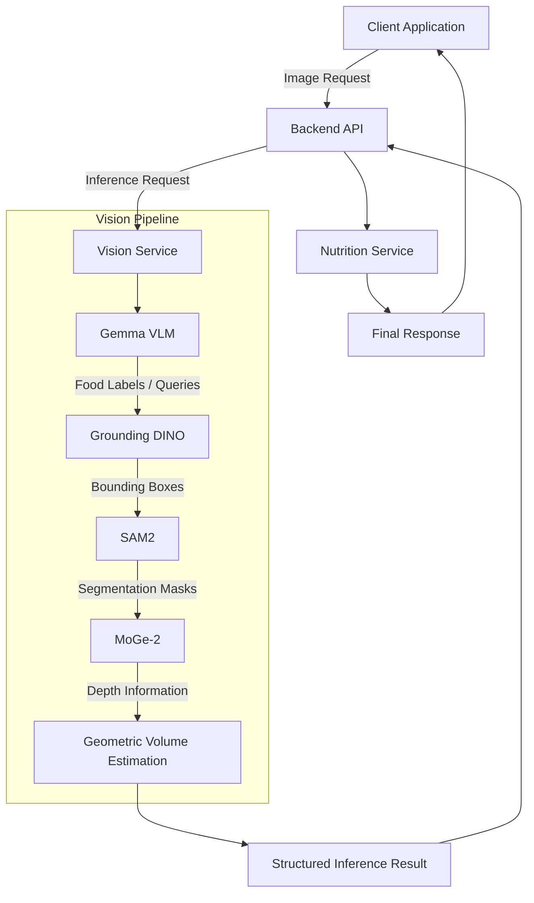

# ActualPlate — AI Food Volume & Nutrition Estimation

ActualPlate is an experimental food-analysis system designed to process a single monocular RGB image. It combines vision models, monocular geometry, and nutrition-provider data to explore food-volume and nutrition estimation.

**Physical volume and nutrition accuracy are not yet independently validated.** A single monocular image does not uniquely establish absolute scale without a metric cue or a learned prior. See Known Limitations before interpreting any volume or nutrition result as a measurement.

## Architecture Overview

ActualPlate separates HTTP API responsibilities from vision inference responsibilities.

The backend handles client requests, application logic, and nutrition data retrieval. The vision service orchestrates the image-processing and inference pipeline.



*The diagram represents the intended high-level inference flow. See the architecture documentation for implementation details and component responsibilities.*

For a detailed explanation, see [System Architecture](docs/architecture/system-overview.md).

## Key Features

- **Single-image food analysis:** Processes a single RGB image as the input to the inference pipeline.
- **Food identification:** Uses a vision-language model to identify food items and generate detection queries.
- **Object detection:** Uses Grounding DINO to identify food regions.
- **Instance segmentation:** Uses SAM2 to obtain food segmentation masks.
- **Depth estimation:** Uses monocular depth estimation to obtain geometric information from the image.
- **Volume research:** Produces geometry diagnostics; authoritative physical volume requires independently validated metric-scale evidence.
- **Nutrition estimation:** Integrates food analysis with nutrition data retrieval.
- **Structured inference results:** Separates internal inference outputs from JSON-compatible response data.

## Engineering Limitations

Food volume estimation from a single RGB image is inherently challenging. The system's output depends on the quality of food identification, object detection, segmentation, depth estimation, and geometric reconstruction.

Some limitations include:

- Hidden food surfaces and unobservable thickness.
- Detection and segmentation inaccuracies.
- Depth estimation errors and geometric uncertainty.
- Irregular and porous food geometries.
- Uncertainty when converting estimated volume into food weight and nutritional values.

We document known limitations, their causes, their impact, and available mitigation strategies rather than presenting estimated values as guaranteed measurements.

See [Known Limitations](docs/KNOWN_LIMITATIONS.md) for details and evaluation evidence.

## Project Structure

```text
ActualPlate/
│
├── requirements/
│   ├── backend.txt
│   └── test.txt
│
├── backend/
│   └── app/
│       ├── api/
│       ├── nutrition/
│       └── services/
│
├── vision_service/
│   ├── detection/
│   ├── inference/
│   └── recognition/
│
├── benchmarks/
│   ├── ablation/
│   ├── diagnostic/
│   ├── evaluation/
│   └── results/
│
├── tests/
│   ├── api/
│   ├── contracts/
│   ├── e2e/
│   ├── regression/
│   ├── security/
│   └── unit/
│
├── scripts/
│   └── diagnostics/
│
└── docs/
    ├── architecture/
    ├── decisions/
    ├── benchmarks/
    ├── DEPLOYMENT.md
    └── KNOWN_LIMITATIONS.md
```

## Getting Started

Refer to the [Deployment Guide](docs/DEPLOYMENT.md) for the verified environment requirements, dependency installation, configuration, startup instructions, and operational procedures.

Do not commit API keys, credentials, model access tokens, or other secrets to the repository.

## Testing

Run the project test suite from the repository root:

```bash
pytest tests/ -v
```

Run individual test categories when investigating specific components:

```bash
pytest tests/unit/ -v
pytest tests/api/ -v
pytest tests/contracts/ -v
pytest tests/regression/ -v
pytest tests/security/ -v
pytest tests/e2e/ -v
```

The test suite covers different levels of system behavior, including unit functionality, API behavior, contracts, regression cases, security checks, and end-to-end workflows.

See [Benchmark Documentation](docs/benchmarks/) for evaluation methodology and benchmark results.

## Documentation

The documentation is organized by engineering responsibility.

| Documentation | Description |
|---|---|
| [System Architecture](docs/architecture/system-overview.md) | High-level system architecture and component relationships |
| [Inference Pipeline](docs/architecture/inference-pipeline.md) | Image processing and inference execution flow |
| [Component Design](docs/architecture/component-design.md) | Module responsibilities and component boundaries |
| [Architecture Decisions](docs/decisions/) | Architecture Decision Records (ADRs) and technical rationale |
| [Known Limitations](docs/KNOWN_LIMITATIONS.md) | Known constraints, failure conditions, and evidence gaps |
| [Deployment Guide](docs/DEPLOYMENT.md) | Environment setup and deployment instructions |
| [Benchmarks](docs/benchmarks/) | Evaluation methodology, experiments, and results |